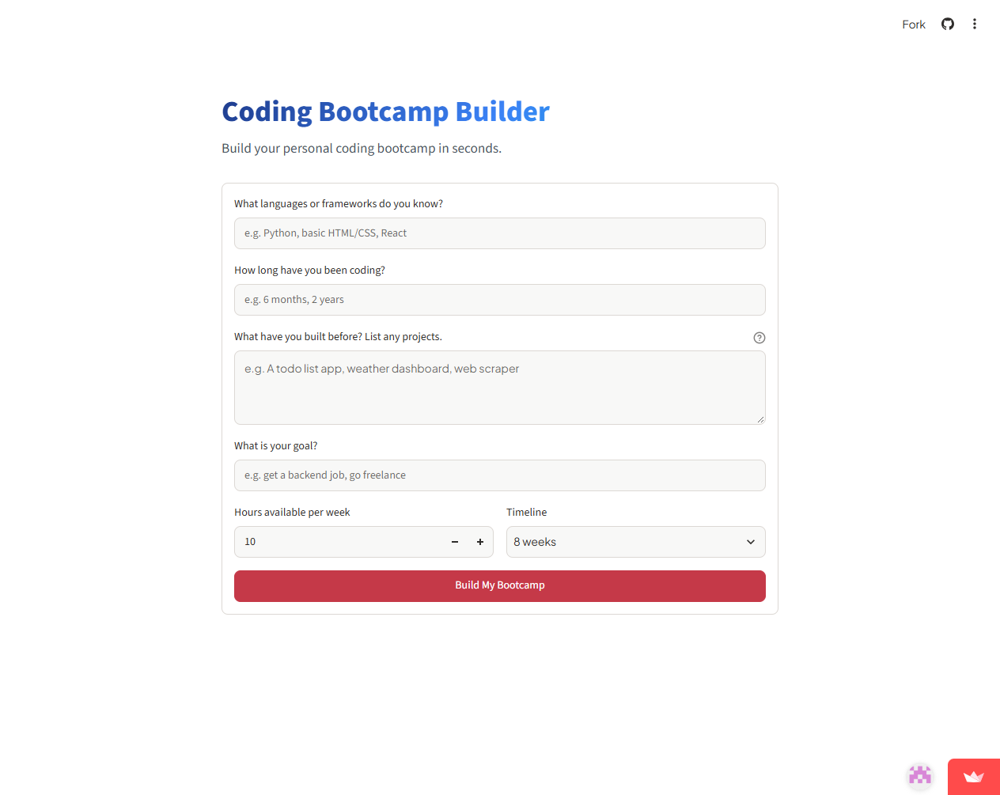
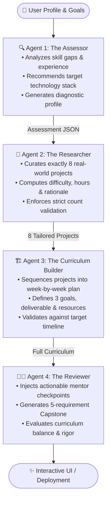

# 🚀 Coding Bootcamp Builder

[](https://coding-bootcamp-builder-we4kusrjhhe6fexuav9fex.streamlit.app/)
[](https://www.python.org/downloads/)
[](LICENSE)
[](https://github.com/AmirSaad1417/coding-bootcamp-builder)

> **Build your personal coding bootcamp in seconds.**  
> A production-grade multi-agent AI system that assesses your technical background, curates tailored projects, sequences them into an actionable week-by-week curriculum, and equips you with testable weekly mentorship checkpoints and a final capstone.

---

## 🌐 Live Application

Access the live, deployed web application here:  
👉 **[https://coding-bootcamp-builder-we4kusrjhhe6fexuav9fex.streamlit.app/](https://coding-bootcamp-builder-we4kusrjhhe6fexuav9fex.streamlit.app/)**

---

## 📸 Application Preview



---

## 💡 Problem Statement

Most aspiring developers learn to code by following arbitrary, disconnected tutorials that neither match their current proficiency nor align with their career goals. 

**Coding Bootcamp Builder** solves this by generating an end-to-end personalized bootcamp tailored to your exact stack, hours per week, and target timeline—backed by a mentor checkpoint every single week to test real-world readiness.

---

## 🤖 Multi-Agent Architecture

The system coordinates four specialized AI agents in a strictly validated sequential pipeline:



### The 4 Agents:
1. **The Assessor (`src/agents/assessor.py`)**: Evaluates language familiarity, years of experience, and past projects to classify proficiency (`beginner`, `intermediate`, `advanced`) and outline precise weak areas.
2. **The Researcher (`src/agents/researcher.py`)**: Queries the LLM to discover exactly 8 tailored projects containing titles, descriptions, skills taught, difficulty, hours, and customized rationale.
3. **The Curriculum Builder (`src/agents/curriculum_builder.py`)**: Maps out a structured weekly timeline matching the user's duration (4, 8, 12, or 16 weeks), generating 3 focused goals, a concrete deliverable, and curated learning resources for every week.
4. **The Reviewer (`src/agents/reviewer.py`)**: Serves as a senior mentor who validates curriculum balance, adds a testable checkpoint question to every week, and crafts a comprehensive Capstone Project with 5 technical specifications.

---

## 🛠️ Tech Stack & Highlights

* **Frontend**: [Streamlit](https://streamlit.io/) with custom UI/UX design (Plus Jakarta Sans typography, card containers, status badges).
* **AI Orchestration**: Multi-Agent system powered by OpenAI / Groq (`openai/gpt-oss-120b`, `gpt-4o-mini`, or Google Gemini).
* **Containerization**: Docker (`python:3.11-slim`) ready for Google Cloud Run or AWS.
* **Security**: Zero-leak architecture; `.env` and secrets are strictly ignored by Git and Docker layers.

---

## 📁 Project Directory Structure

```text
coding-bootcamp-builder/
├── .dockerignore              # Excludes secrets and temporary artifacts from containers
├── .env.example               # Template for environment variables
├── .gitignore                 # Enforces security; prevents committing secret keys
├── Dockerfile                 # Production Docker container configuration
├── README.md                  # Comprehensive project documentation
├── requirements.txt           # Project dependencies
├── assets/
│   └── app_preview.png        # UI screenshot preview
└── src/
    ├── __init__.py
    ├── app.py                 # Streamlit web application with modern UI
    ├── main.py                # Headless CLI pipeline verification script
    └── agents/
        ├── __init__.py        # Clean agent package exports
        ├── assessor.py        # Diagnostic & profile evaluation agent
        ├── researcher.py      # Project discovery & validation agent
        ├── curriculum_builder.py # Timeline sequencing agent
        └── reviewer.py        # Mentorship checkpoints & capstone agent
```

---

## ⚡ Quickstart & Local Setup

### 1. Clone the Repository
```bash
git clone https://github.com/AmirSaad1417/coding-bootcamp-builder.git
cd coding-bootcamp-builder
```

### 2. Create and Activate Virtual Environment
```bash
# Windows
python -m venv .venv
.venv\Scripts\activate

# macOS / Linux
python3 -m venv .venv
source .venv/bin/activate
```

### 3. Install Dependencies
```bash
pip install -r requirements.txt
```

### 4. Configure Environment Variables
Copy `.env.example` to `.env`:
```bash
cp .env.example .env
```
Edit `.env` with your API credentials (Groq, OpenAI, or Gemini):
```env
OPENAI_API_KEY=your_api_key_here
OPENAI_BASE_URL=https://api.groq.com/openai/v1
OPENAI_MODEL=openai/gpt-oss-120b
```

### 5. Run Headless Pipeline Test
Verify all 4 agents execute in sequence:
```bash
python src/main.py
```

### 6. Launch Streamlit Web UI
```bash
streamlit run src/app.py
```
Open your browser at `http://localhost:8501`.

---

## 🐳 Docker & Cloud Run Deployment

You can containerize and deploy this application anywhere Docker is supported:

```bash
# Build the Docker image
docker build -t coding-bootcamp-builder .

# Run the container locally on port 8080
docker run -p 8080:8080 --env-file .env coding-bootcamp-builder
```

---

## 🔒 Security & Secrets Management

* **No Secrets in Source Control**: `.env` is permanently excluded via `.gitignore` and `.dockerignore`.
* **Streamlit Cloud Deployment**: Production keys are managed exclusively through Streamlit Cloud's encrypted Secrets Vault (`secrets.toml`).

---

## 👤 Author

* **Amir Saad**
* GitHub: [@AmirSaad1417](https://github.com/AmirSaad1417)
* Email: [saadkhan1417@gmail.com](mailto:saadkhan1417@gmail.com)

---

## 📄 License

This project is licensed under the MIT License - feel free to use and adapt it for your learning journey!
